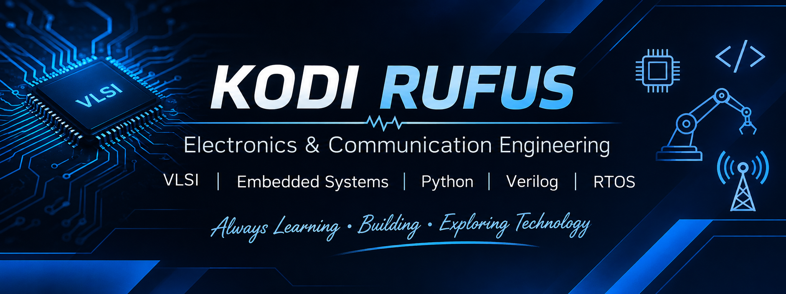

# Hi, I'm KODI RUFUS 👋

### Electronics & Communication Engineering Student | VLSI | Embedded Systems

I'm a final-year B.Tech Electronics and Communication Engineering student passionate about VLSI design, Embedded Systems, and emerging technologies.

I enjoy exploring hardware-software integration, developing engineering projects, and continuously improving my technical skills.

---

## 🎓 Education

**B.Tech – Electronics & Communication Engineering**  
Dr. Lankapalli Bullayya College of Engineering  
2024–2027 | CGPA: 8.31

**Diploma – Electronics & Communication Engineering**  
Government Polytechnic, Pendurthi  
2020–2023 | 83.5%

---

## 🛠️ Technical Skills

- **Programming:** C, Python
- **Hardware & Electronics:** Embedded Systems, Sensors & Actuators, Hardware Interfacing
- **Core Interests:** VLSI, Verilog HDL, RTOS Fundamentals
- **Other:** Web Development, MS Office

---

## 🚀 Projects

### 1. AI Surveillance Car – ESP32-CAM
[View Project Repository](https://github.com/Kodi-rufus/AI-Surveillance-Car-ESP32-CAM)

- Wi-Fi controlled surveillance car with live camera streaming.
- ESP32-CAM, L298N motor driver and embedded systems.
- **First Prize – Technostav 2K26.**

### 2. Agentic AI-Based RF Signal Analysis & Classification
[View Project Repository](https://github.com/Kodi-rufus/Agentic-AI-RF-Signal-Analysis)

- Python-based RF signal analysis and modulation classification.
- Signal processing and parameter estimation.
- Introduction to Agentic AI workflows.

### 3. Building Management System (BMS)
- Academic engineering project involving building management concepts.

---

## 🏆 Achievement

- First Prize – AI Surveillance Car Project, Technostav 2K26.

---

## 📜 Certifications & Training

- NPTEL – Sensors & Actuators
- NPTEL – Micro/Nano Sensors
- Python & Web Development – JNCC Technologies
- RTOS Internship
- Python & Agentic AI Frameworks Internship

---

## 🌱 Currently Learning

- Verilog HDL
- VLSI Design
- Embedded Systems

---

## 📫 Connect With Me

- **LinkedIn:** Add your LinkedIn profile URL here
- **Location:** Visakhapatnam, Andhra Pradesh, India

---

*Always learning, building, and exploring technology.*
