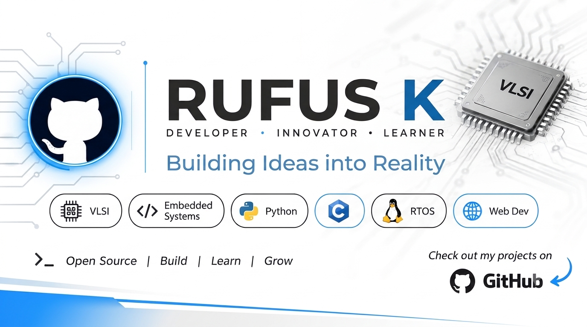

# Hi, I'm KODI RUFUS 👋

### Electronics & Communication Engineering Student | VLSI | Embedded Systems

I'm a final-year B.Tech Electronics and Communication Engineering student passionate about VLSI design, Embedded Systems, and emerging technologies.

I enjoy exploring hardware-software integration, developing engineering projects, and continuously improving my technical skills.

---

## 🎓 Education

**B.Tech – Electronics & Communication Engineering**  
Dr. Lankapalli Bullayya College of Engineering  
2024–2027 | CGPA: 8.31

**Diploma – Electronics & Communication Engineering**  
Government Polytechnic, Pendurthi  
2020–2023 | 83.5%

---

## 🛠️ Technical Skills

- **Programming:** C, Python
- **Hardware & Electronics:** Embedded Systems, Sensors & Actuators, Hardware Interfacing
- **Core Interests:** VLSI, Verilog HDL, RTOS Fundamentals
- **Other:** Web Development, MS Office

---

## 🚀 Projects

### 1. AI Surveillance Car – ESP32-CAM

Wi-Fi-controlled surveillance car with live camera streaming and wireless mobile access.

- ESP32-CAM and L298N motor driver integration.
- Live video streaming through a mobile browser.
- Embedded systems and Wi-Fi communication.

🏆 **First Prize – Technostav 2K26**

🔗 [View Project Repository](https://github.com/Kodi-rufus/AI-Surveillance-Car-ESP32-CAM)

---

### 2. Agentic AI-Based RF Signal Analysis & Classification

Python-based project exploring RF signal simulation, analysis, modulation classification and parameter estimation.

- RF signal processing and FFT analysis.
- Digital and analog modulation concepts.
- Exploration of Agentic AI workflows.

🔗 [View Project Repository](https://github.com/Kodi-rufus/Agentic-AI-RF-Signal-Analysis)

---

### 3. WCS – Wireless Communication I/O Transfer System

Gained hands-on industrial exposure during a six-month diploma internship at Lotus Wireless, working in the presence and under the guidance of an industry professional.

- Radio modems and wireless communication.
- RTUs, PLCs and SCADA concepts.
- Industrial I/O systems and PCB processes.

🔗 [View Project Repository](https://github.com/Kodi-rufus/WCS-Wireless-Communication-IO-System)

---

### 4. BMS – Building & Light Management System

Academic project explored through a practical demonstration, with opportunities to observe components, understand system operation and operate the setup.

- ESP32-WROOM and IoT concepts.
- Embedded systems and PCB components.
- Wi-Fi connectivity and smart lighting management.
- Firebase, MQTT and WebSocket concepts.

🔗 [View Project Repository](https://github.com/Kodi-rufus/BMS-Building-Light-Management-System)

---

## 🏆 Achievements

- First Prize – AI Surveillance Car Project, Technostav 2K26.

---

## 📜 Certifications & Training

- NPTEL – Sensors & Actuators
- NPTEL – Micro/Nano Sensors
- Python & Web Development – JNCC Technologies
- RTOS Internship
- Python & Agentic AI Frameworks Internship

---

## 🌱 Currently Learning

- Verilog HDL
- VLSI Design
- Embedded Systems

---

## 📫 Connect With Me

- **LinkedIn:** [KODI RUFUS](https://www.linkedin.com/in/kodi-rufus/)
- **Location:** Visakhapatnam, Andhra Pradesh, India

---

*Always learning, building, and exploring technology.*

## 📊 GitHub Statistics

